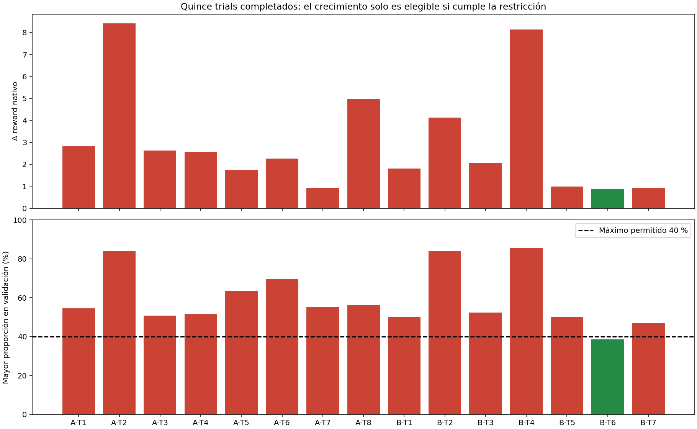

# v11 A frente a v11 B — resultados parciales

A terminó controladamente a11h, estado partial:8 trials completos y trial9 episodio851. B:7 completos y trial8 episodio896. En conjunto16747/20000 episodios; faltan3253. No hay test ni ganadora definitiva.

## Conclusión

**B6 sigue siendo el único candidato factible entre15 trials completos. A no tiene candidato elegible todavía.** Esto significa que B6 es el mejor provisional bajo la regla acordada, no que se haya demostrado superioridad predictiva general.

A2 tiene el mayor crecimiento de A,8.419362, pero concentración84.09% y queda excluido. A3 es el más cercano al límite en A,50.76%, todavía no factible. B6 crece0.890029 y su máxima proporción es38.64%. Los pesos cambian la escala del reward; el crecimiento se interpreta como el criterio aprobado, no como una medida universal de calidad predictiva.

## B6: candidato provisional

Alpha0.9672430610, beta0.1053078723, eta0.9215749166, lambda0.1006156445. Checkpoint520 elegido dentro del trial por validación. A1=51/132 (38.64%), A2=40/132 (30.30%), A3=41/132 (31.06%), A4=0. Cumple el máximo agregado, no obliga a usar cuatro acciones ni a cumplir por escenario.

Validación B6: AUC diaria media 0.589172, AP diaria media 0.053081. No comparar esas métricas de validación con test de otra versión. No hay métricas comparables del mejor A: sus8 configuraciones completas fueron descartadas y solo se conservan resúmenes/curvas por diseño.

## Evidencia y recuperación

A: 159 archivos (412066141 bytes), inventario/tamaños verificados, SHA256 locales registrados, estado BO legible,8 observaciones y trial9 activo. CRC del snapshot activo correcto,851 episodios y28083 decisiones confirmados. No existe manifiesto remoto final porque el run es partial.

Preparación, pacientes, calendario, normalización inicial y denominador A4 idénticos entre A/B por hash. Los15 puntos completados son distintos. No se han verificado nuevos resultados de test ni ejecutado una reanudación. El respaldo completo de ambas ejecuciones ya está descargado; no se lanzó entrenamiento nuevo.

Tablas: completed_trials_a_b.csv, progress_a_b.csv, b6_validation_metrics.csv.

