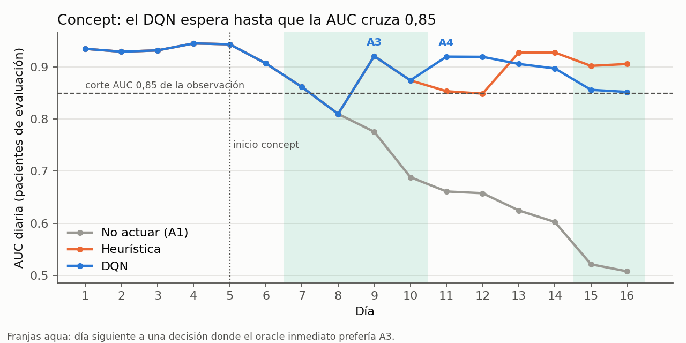
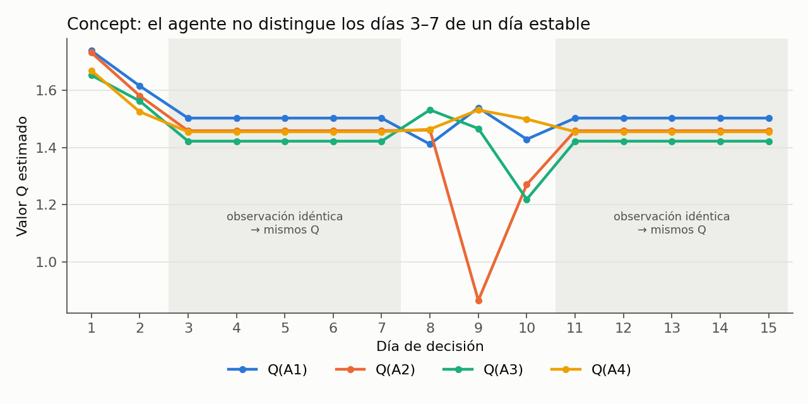
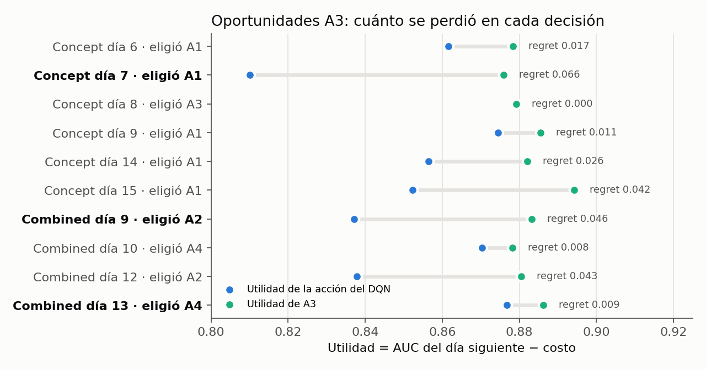
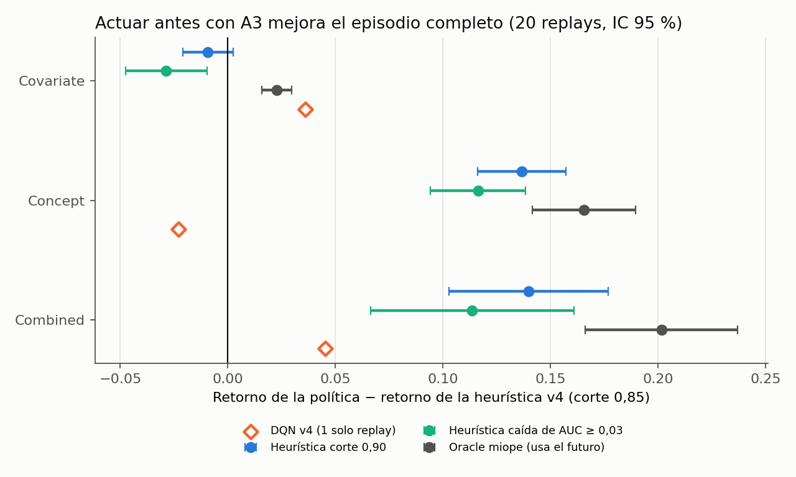

# DQN dummy v4: explicación, decisión trazada y oportunidades A3

Fuente: `kaggle/dqn-dummy/v4/input/main.ipynb` y sus salidas en
`kaggle/dqn-dummy/v4/outputs/`. La tabla y las figuras de este documento están en
`kaggle/dqn-dummy/v4/outputs/analisis/`. Todas las cifras salen de los CSV de la
corrida `jeffreyamc/darl-dqn-dummy-v4` (semilla 42, checkpoint 940).

El diagnóstico `plan/diagnostico_a3_v4.md` no está en el repositorio (en ninguna
rama), así que las conclusiones se comprobaron directamente con los CSV.

## 1. El notebook por bloques

| Bloque (celdas) | Qué recibe | Qué hace | Qué produce |
|---|---|---|---|
| Preparación de PhysioNet (3–5) | `physionet.parquet` (40.336 pacientes, 1,55 M filas) | Selecciona 7 vitales (HR, O2Sat, Temp, SBP, MAP, DBP, Resp). Ordena por paciente y hora y rellena faltantes con el último valor del mismo paciente (*forward fill*). | Tabla horaria limpia y sin información futura. |
| Particiones (7) | Pacientes de los hospitales A y B | Divide A en 70/15/15 y B en 60/20/20, por paciente y estratificando por sepsis. Dentro de B separa pacientes de *update* y de *eval*. | Seis grupos disjuntos (comprobados con `assert`). |
| Etiqueta `y_dummy` (7) | Vitales normalizados con la mediana y el IQR de A-train | Calcula un score lineal con pesos fijos. Si supera la mediana, la etiqueta es 1. Luego invierte el 5 % al azar. | Etiqueta artificial con prevalencia 0,47. No es la sepsis real. |
| Simulación temporal (9) | Pacientes de un grupo B | Ocupa 100 camas de update y 100 de eval. Cuando un paciente termina, entra otro. | 16 días × 24 h × 200 camas (2.400 filas por día y rol). |
| Pipeline y acciones (11) | Filas de update del día | Normaliza con mediana/IQR recortando a ±2 y clasifica con XGBoost. Acciones: **A1** no hacer nada, **A2** recalcular la mediana y el IQR, **A3** reentrenar XGBoost, **A4** ambas. | Pipeline nuevo, tiempo de la acción y costo (A2 ≈ 0,009, A3 ≈ 0,040, A4 = 0,05). |
| Drift gradual (13, 23) | Replay y velocidades calibradas con B-train | **Covariate:** desplaza los vitales 0,25 IQR por día. **Concept:** mueve 0,15 por día los pesos que definen la etiqueta. Ambos empiezan el día 5. **Combined:** aplica los dos, y concept empieza 2 días después. | Escenarios stable, covariate, concept y combined. |
| Estado (15) | Filas del día y pipeline actual | Calcula el KS y el PSI máximos contra la última referencia, y la AUC de los pacientes eval. Cada métrica se convierte en 3 categorías. | Vector de 30 valores: 10 por día durante 3 días. |
| Reward (17) | Acción del día *d* | Aplica la acción y mide el día *d+1*. | `reward = AUC(d+1) − 0,05 · segundos / segundos de A4` |
| Agente (19, 27) | Transiciones (estado, acción, reward, siguiente estado) | Double DQN, entrenado entre 500 y 1000 episodios. | Política elegida en el episodio 940 por validación. |
| Evaluación (25, 31) | B-test con los 4 escenarios | Compara el DQN con A1–A4 fijas, aleatoria y heurística, y audita cada decisión con un *oracle* inmediato. | Los CSV de `outputs/` y los *gates*. |

**Double DQN, en lo conceptual.** La red estima un valor Q para cada acción: la
recompensa futura esperada si se elige esa acción en el estado actual. El agente
elige la de mayor Q. El DQN normal tiende a sobrestimar porque usa la misma red
para elegir la acción siguiente y para valorarla. Double DQN separa los papeles:
la red *online* elige la acción y una copia congelada (red *target*) la valora.
Esto reduce el sesgo optimista.

## 2. Una decisión completa: concept, día 7

**Lo que el agente sabía al decidir** (cierre del día 7):

- **KS máximo:** 0,069, categoría baja (< 0,10).
- **PSI máximo:** 0,020, categoría baja.
- **AUC del día:** 0,862, categoría alta (≥ 0,85). Se calcula con las etiquetas de
  ese mismo día; el v4 supone que llegan sin retraso.
- **Los dos días anteriores** también estaban en bajo/bajo/alto (AUC 0,944 y 0,907).

Ese vector de 30 valores es **idéntico** al de un día estable. Por eso los valores
Q son exactamente los mismos que en el escenario stable desde el día 3:
Q(A1) = 1,502, Q(A2) = 1,458, Q(A3) = 1,422 y Q(A4) = 1,455. Se elige **A1**.

**Lo que pasó al día siguiente:**

- AUC del día 8 = 0,810.
- Costo de A1 ≈ 0.
- Reward = 0,810.

**Lo que solo conoce la auditoría después:**

- La severidad oculta del concept ese día era 0,45.
- El *oracle* aplica las cuatro acciones sobre el mismo pipeline y el mismo día 8.
  Utilidades: A1 0,810, A2 0,786, **A3 0,876**, A4 0,863.
- *Regret* (lo perdido frente a la mejor acción) = 0,066, el mayor de todo el
  experimento.

**Figura A.** Sin actuar, la AUC cae de 0,94 a 0,51. El DQN y la heurística siguen
la misma curva hasta el día 8, porque ninguno actúa mientras la AUC está sobre
0,85. El DQN corrige con A3 el día 8 y con A4 el día 10. Después de eso vuelve a
quedar sobre el corte y no reacciona a la nueva caída de los días 14 y 15.

## 3. Lo que dicen los CSV

- **`actions.csv` (policy = dqn):** no hubo ningún *fallback* (siempre se ejecutó
  la acción pedida). El costo real de A3 varía entre 0,036 y 0,081 según el tiempo
  medido en Kaggle, así que el reward incluye ruido de la CPU.
- **`action_audit.csv`:** el DQN coincide con el *oracle* en 49 de 60 decisiones.
  Todo el *regret* está en concept (0,161) y combined (0,115); en stable y
  covariate es 0.
- **`training_history.csv`:**
  - La elección de A3 durante el entrenamiento baja del 21 % al 7 %.
  - En validación, A3 pasa de ~14 a ~3–5 decisiones de 60.
  - La coincidencia entre checkpoints consecutivos promedia 0,37–0,74 por bloque
    de 100 episodios, y baja hasta 0,35 cerca del final. La política no se
    estabiliza.
- **`policy_comparison.csv`** (retorno de 15 decisiones):

| Escenario | DQN | Heurística | A1 | A3 fija |
|---|---|---|---|---|
| covariate | **13,843** | 13,807 | 11,794 | 12,606 |
| concept | 13,382 | **13,405** | 11,369 | 13,271 |
| combined | **13,467** | 13,422 | 11,700 | 12,556 |

## 4. Tabla de oportunidades A3

Decisiones en las que el *oracle* inmediato prefería A3
(`analisis/tabla_oportunidades_a3.csv`):

| Escenario | Día | Elegida | Utilidad A3 | Utilidad elegida | Regret | AUC observada | KS | PSI |
|---|---|---|---|---|---|---|---|---|
| concept | 6 | A1 | 0,878 | 0,862 | 0,017 | 0,907 | 0,07 | 0,02 |
| **concept** | **7** | **A1** | **0,876** | **0,810** | **0,066** | 0,862 | 0,07 | 0,02 |
| concept | 8 | A3 | 0,879 | 0,879 | 0,000 | 0,810 | 0,06 | 0,03 |
| concept | 9 | A1 | 0,885 | 0,874 | 0,011 | 0,921 | 0,07 | 0,02 |
| concept | 14 | A1 | 0,882 | 0,856 | 0,026 | 0,897 | 0,08 | 0,05 |
| concept | 15 | A1 | 0,894 | 0,852 | 0,042 | 0,856 | 0,09 | 0,05 |
| **combined** | **9** | **A2** | **0,883** | **0,837** | **0,046** | 0,887 | 0,23 | 0,14 |
| combined | 10 | A4 | 0,878 | 0,870 | 0,008 | 0,846 | 0,23 | 0,22 |
| combined | 12 | A2 | 0,880 | 0,838 | 0,043 | 0,890 | 0,35 | 8,19 |
| **combined** | **13** | **A4** | **0,886** | **0,877** | **0,009** | 0,847 | 0,26 | 0,15 |

El DQN aprovecha 1 de 10 oportunidades, pero los fallos son de dos tipos distintos.

- **Concept, día 7: no ve el problema.** Es el caso de la sección 2. La AUC sigue
  sobre 0,85, así que el estado es el mismo que un día estable. En esos estados,
  A3 casi siempre pierde: cuesta 0,04 y, sin drift, reentrenar con un solo día
  baja la AUC (A3 fija en stable da 0,932 frente a 0,940). Lo mismo pasa en los
  días 6, 14 y 15.
- **Combined, día 9: confunde el tipo de cambio.** KS (0,23) y PSI (0,14) están en
  la categoría media, y la AUC (0,887) todavía es alta. El estado se parece a
  covariate, donde A2 cada día es lo correcto, así que elige A2 (Q 1,136 frente a
  1,015 de A3). Pero el concept ya va en 0,45, y solo A3 lo corrige. Pierde 0,046.
  En el día 12 se repite el patrón.
- **Combined, día 13: dirección correcta, pero paga de más.** La AUC (0,847) bajó
  del corte y el agente elige A4 con claridad (Q 0,956). A4 incluye A3 y logra la
  misma AUC al día siguiente (≈ 0,929); el *regret* de 0,009 es solo la diferencia
  de costo entre A4 y A3. Con esas métricas, la regla de la heurística habría
  elegido A3 (KS < 0,30, PSI < 0,25 y AUC < 0,85).

**Figura B.** Los valores Q quedan planos en los días 3–7 y 11–15. No es que el
agente "decida esperar": recibe exactamente la misma entrada que en un día estable.
Q(A3) solo supera a Q(A1) el día 8, cuando la AUC cae a la categoría media.

**Figura C.** Cada fila es una oportunidad. La distancia entre el punto azul y el
verde es el *regret*. Las pérdidas grandes (≥ 0,04) aparecen cuando la AUC aún está
sobre 0,85 (concept 7 y 15) o cuando hay señales de covariate que tapan el concept
(combined 9 y 12).

## 5. Hallazgos

**Qué funciona.**
- En covariate el DQN coincide con el *oracle* en las 15 decisiones y supera a
  todas las acciones fijas.
- En los tres escenarios con drift recupera la AUC frente a no actuar: de 0,77–0,80
  a 0,90–0,93.
- No actúa en stable.

**Dónde falla.** Llega tarde al concept drift y desaprovecha A3: 9 de 10
oportunidades, con *regret* total de 0,27. Frente a la heurística empata o pierde
(concept −0,023).

**Posibles explicaciones, de más a menos respaldada:**

1. **Estados indistinguibles.** El corte de AUC en 0,85 junta los días con concept
   temprano y los días estables (figura B, comprobado con los valores Q).
2. **Señales mezcladas en combined.** KS y PSI miden solo el cambio de medición;
   cuando aparecen, el agente atribuye la caída a covariate (combined 9 y 12).
3. **A3 se refuerza poco.** En los estados donde se prueba, casi siempre pierde, y
   su elección cae del 21 % al 7 % durante el entrenamiento.
4. **Ruido en el reward.** El costo medido de A3 varía más (0,036–0,081) que muchas
   de las diferencias que el agente debe aprender.

**Evidencia que falta:**

- **Más corridas:** varias semillas o replays de prueba, con intervalos de
  confianza. Hoy las diferencias con la heurística (≤ 0,045) caen dentro del
  ruido diario de la AUC (desviación 0,006 por día en stable).
- **Un contrafactual de largo plazo:** el *oracle* es de un paso. Falta comprobar si
  usar A3 en esas oportunidades mejora el retorno de todo el episodio (A3 fija
  sube la AUC a 0,927, pero su retorno es menor por costo).
- **Una ablación con observación continua**, o con la última acción y los días
  desde la última actualización, para confirmar la explicación 1.
- **Un costo fijo por acción**, para descartar la explicación 4.

## 6. Experimento sin entrenar: ¿actuar antes con A3 mejora el episodio?

**Qué se hizo.** Se reutilizaron las celdas de definiciones del notebook v4 (datos,
pipeline, drift, monitor y entorno) y se compararon políticas fijas, sin entrenar
ningún DQN, en 20 replays de B-test (semillas 42–61):

- **Costo:** fijo por acción, con los valores de la corrida en Kaggle, para quitar el
  ruido de la CPU.
- **Velocidades del drift:** las calibradas en v4.
- **Reproducción:** en el replay 42, la heurística v4 obtiene en concept 13,412
  (13,405 en Kaggle, con el costo medido).

Políticas:

| Política | Regla |
|---|---|
| Heurística v4 | A2 si KS ≥ 0,30 o PSI ≥ 0,25; A3 si AUC < **0,85**; A4 si ambas. |
| Heurística 0,90 | Igual, con corte de AUC en **0,90**. |
| Heurística caída | A3 si la AUC cae ≥ 0,03 desde la última actualización del modelo (o < 0,85). |
| Periódica | A3 cada 3 días; A2 si hay señal de covariate. |
| Oracle miope | La mejor acción para el día siguiente. **Usa etiquetas futuras**: solo es referencia. |

Resultados: diferencia de retorno frente a la heurística v4, con IC 95 % pareado
(`analisis/exp_heuristicas/resumen.csv`):

| Escenario | Corte 0,90 | Caída de AUC | Oracle miope | Periódica |
|---|---|---|---|---|
| Stable | 0,000 (0 acciones) | 0,000 (0 acciones) | 0,000 | −0,314 ± 0,007 |
| Covariate | −0,009 ± 0,012 | −0,029 ± 0,019 | +0,023 ± 0,007 | −0,103 ± 0,021 |
| Concept | **+0,137 ± 0,021** (20/20) | **+0,116 ± 0,022** (20/20) | +0,166 ± 0,024 | +0,036 ± 0,024 |
| Combined | **+0,140 ± 0,037** (19/20) | **+0,114 ± 0,047** (17/20) | +0,202 ± 0,035 | −1,105 ± 0,295 |

Entre paréntesis: en cuántos de los 20 replays la política supera a la heurística v4.

**Figura D.** Los puntos son medias de 20 replays con IC 95 %. El rombo es el DQN
v4 en su único replay de prueba.

**Lectura:**

- **Actuar antes con A3 mejora el episodio completo, no solo el día siguiente.**
  - En concept, subir el corte a 0,90 adelanta la primera A3 del día 8 al día 7 y
    gana 0,137 en las 20 réplicas.
  - En concept, captura el 83 % de la ventaja del oracle miope.
  - Sin drift no genera falsas alarmas, y en covariate pierde muy poco (−0,009).
- **Esto respalda la explicación 1.** La información para reaccionar antes está en
  la AUC, pero la observación categórica del DQN la pierde.
  - En el mismo replay de prueba del v4, la heurística 0,90 supera al DQN en
    concept (13,555 frente a 13,382) y en combined (13,555 frente a 13,467).
  - El DQN solo es mejor en covariate (13,843 frente a 13,812).
- **Una sola corrida no basta para comparar políticas.** Entre replays, la
  diferencia pareada tiene una desviación de 0,04–0,10. Las diferencias del v4
  entre el DQN y la heurística (+0,036, −0,023 y +0,045) caen dentro de ese rango.
- **Actuar por calendario no sirve.** La política periódica pierde en casi todos
  los escenarios.

**Límites:**

- Los cortes 0,90 y 0,03 se eligieron a mano y se probaron directamente en B-test.
  Para afirmarlo en la tesis hay que elegirlos en B-val.
- Los 20 replays reordenan los mismos pacientes de B-test, así que no son del todo
  independientes.

Script: `analisis/exp_heuristicas/run.py`. Corre en unos 5 minutos en CPU y
necesita `data/processed/physionet/physionet.parquet`.
